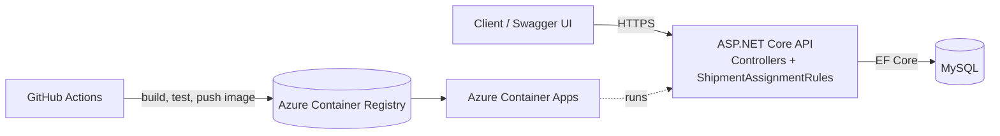
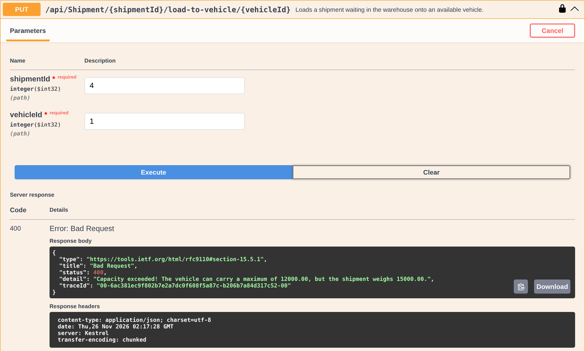

    
[](https://github.com/bcpasaoglu/Logistic-Workflow-API/actions/workflows/ci.yml)

# Project Purpose

This project is a Logistics Workflow API project that I developed from scratch in order to **apply, test, and reinforce what I have learned** while taking my first steps into the .NET ecosystem and backend development.

Rather than creating only a simple "add/delete data" CRUD application, I aimed to implement real-world business rules in code and establish interconnected database relationships.

---

## What Did I Learn and Apply in This Project?

Throughout the development process, I researched and solved the problems I encountered, and I had the opportunity to practise the following topics:

* **Entity Framework Core & MySQL Integration:** I created database tables through C# code using the Code-First approach and learned the logic of `Migration`.
* **Business Logic Implementation:**

  * While assigning a shipment to a vehicle, I wrote validation algorithms that check the vehicle's **availability status** and **maximum carrying capacity**.
  * I ensured that the system rejects the request if the capacity is exceeded, and automatically updates the vehicle status to `OnRoute` if all conditions are met.
* **Flexible API Design:** To simulate real-life processes, I designed flexible Controller methods that support different scenarios, such as assigning shipments directly to a vehicle or storing them in the warehouse first and loading them onto a vehicle later.
* **Error Resolution and Architectural Configuration:**

  * While retrieving relational data, such as the vehicle inside a shipment or the shipments inside a vehicle, I learned how to solve the **Object Cycle** error by using `ReferenceHandler.IgnoreCycles`.
  * In order to connect the project to a frontend application in the future, I researched, learned about, and successfully configured **CORS policies** that allow requests from external applications.

---

## Technologies Used

* **Language & Framework:** C#, .NET 9, ASP.NET Core Web API, ASP.NET Core Identity, JWT bearer authentication
* **Database & ORM:** MySQL 8, Entity Framework Core (Code-First migrations, Pomelo provider)
* **API Documentation:** Swagger / OpenAPI generated from XML doc comments
* **Testing:** xUnit, EF Core InMemory, `WebApplicationFactory` integration tests
* **DevOps & Cloud:** Docker, docker-compose, GitHub Actions (CI + CD), Terraform, Azure Container Apps, Azure Database for MySQL, Azure Container Registry
* **Architectural Concepts:** Asynchronous Programming (`async/await`), RESTful API Design, RFC 7807 ProblemDetails, health checks, pagination

---

## Architecture



More diagrams (request pipeline, shipment lifecycle, data model, Azure deployment) are in [docs/architecture.md](docs/architecture.md).

---

## API Overview


| Method | Endpoint | Description |
| --- | --- | --- |
| `GET` | `/api/Vehicle?page=1&pageSize=20` | Paged list of vehicles |
| `GET` | `/api/Vehicle/status/{status}` | Paged list filtered by `Available`, `OnRoute` or `InMaintenance` |
| `GET` / `PUT` / `DELETE` | `/api/Vehicle/{id}` | Read, update or delete a vehicle (delete is refused with `409` while shipments are assigned) |
| `POST` | `/api/Vehicle` | Register a vehicle |
| `GET` | `/api/Shipment?page=1&pageSize=20&status=Pending` | Paged list of shipments, newest first, optional status filter |
| `GET` / `PUT` / `DELETE` | `/api/Shipment/{id}` | Read, update or delete a shipment (in-transit shipments cannot be deleted) |
| `POST` | `/api/Shipment/warehouse` | Store a shipment in the warehouse without a vehicle |
| `POST` | `/api/Shipment/assign-direct` | Create a shipment and load it onto a vehicle after capacity checks |
| `PUT` | `/api/Shipment/{shipmentId}/load-to-vehicle/{vehicleId}` | Load a warehouse shipment onto an available vehicle |
| `PUT` | `/api/Shipment/{id}/deliver` | Mark an in-transit shipment `Delivered` and return its vehicle to `Available` |
| `POST` | `/api/auth/register` | Register a user (ASP.NET Core Identity, public) |
| `POST` | `/api/auth/login` | Exchange email + password for a JWT access token (public) |
| `GET` | `/api/auth/me` | The user the token belongs to |
| `GET` | `/health/live`, `/health/ready` | Liveness and readiness (database) probes |

**Authentication:** all vehicle and shipment endpoints require `Authorization: Bearer <token>`. Register, call `/api/auth/login`, then press **Authorize** in Swagger UI and paste the `accessToken`. Tokens are HS256-signed JWTs (30 minutes) validated for issuer, audience, lifetime and signature; failed logins count towards Identity's lockout (5 attempts → 15 minutes), and unknown emails and wrong passwords return the same message. The signing key is never in the repository: the app refuses to start without a key of at least 32 bytes.

**Pagination:** list endpoints return

```json
{ "items": [ ... ], "page": 1, "pageSize": 20, "totalCount": 42, "totalPages": 3, "hasNextPage": true, "hasPreviousPage": false }
```

`pageSize` is limited to 100. A real request against the demo data, executed in Swagger UI with a JWT:


**Errors:** every error response uses [RFC 7807 ProblemDetails](https://www.rfc-editor.org/rfc/rfc7807) with a `traceId`: validation errors, business rule violations (`400`/`404`/`409` with the reason in `detail`) and unhandled exceptions, which a global `IExceptionHandler` maps to `409` for database conflicts and `500` otherwise, without exposing exception details outside Development. Loading a 15,000 kg shipment onto a 12,000 kg truck:



Enums are sent and accepted as names (`"OnRoute"`), and tracking numbers are unique.

---

## Running with Docker

```bash
docker compose up --build
# API + Swagger UI: http://localhost:8080/swagger
```

`docker-compose.yml` starts MySQL 8.4 and the API. The API applies EF Core migrations on startup (`Database__MigrateOnStartup=true`), so no manual database setup is needed. The default database passwords in the compose file are for local development only; override them with `MYSQL_PASSWORD` and `MYSQL_ROOT_PASSWORD`.

## Running Locally

```bash
dotnet user-secrets set "ConnectionStrings:DefaultConnection" "Server=localhost;Port=3306;Database=logisticdesk;User=...;Password=...;"
dotnet user-secrets set "Jwt:SigningKey" "$(openssl rand -base64 48)"
dotnet ef database update
dotnet run
```

Connection strings and the JWT signing key are never committed: locally they come from user secrets, in Docker from environment variables and on Azure from Container Apps secrets generated by Terraform.

## Tests

```bash
dotnet test LogisticDesk.slnx
```

The `tests/LogisticDesk.Tests` project has 47 tests. Unit tests call the rules and controllers directly; integration tests boot the real pipeline with `WebApplicationFactory` (routing, JWT auth, validation, ProblemDetails) on an in-memory database. They cover:

* capacity limits, including a shipment exactly at capacity
* rejecting vehicles that are on route or in maintenance
* warehouse → vehicle loading and the resulting status changes
* updates cannot bypass the capacity checks by changing the vehicle or raising the weight
* pagination metadata, page size limits and status filters
* delete rules (vehicles with shipments, shipments in transit) and duplicate tracking numbers
* mapping of exceptions to HTTP status codes
* delivery: a delivered shipment frees its vehicle, and cannot be delivered twice
* JWT: protected endpoints return `401` without a token or with a tampered one, login → token → `/api/auth/me`, short signing keys are refused
* the full workflow over HTTP: register, login, create vehicle, assign, deliver
* business rule errors returned as ProblemDetails with the reason and a `traceId`

## CI/CD and Cloud Deployment

* **CI** ([ci.yml](.github/workflows/ci.yml)) runs on every push and pull request: build, tests, Docker image build, `terraform fmt` and `terraform validate`.
* **CD** ([cd.yml](.github/workflows/cd.yml)) runs after CI passes on `main`: logs in to Azure with OpenID Connect (no stored secrets), pushes the image to Azure Container Registry, rolls out a new Container Apps revision and smoke tests `/health/ready`.
* **Infrastructure as Code** ([infra/terraform](infra/terraform)) provisions the resource group, container registry, managed identity, MySQL flexible server, Log Analytics and the container app. The database password and JWT signing key are generated by Terraform and never stored in Git.

Step-by-step deployment guide: [infra/README.md](infra/README.md).

## Project Structure

```
Controllers/        Auth, Shipment and Vehicle endpoints
Services/           ShipmentAssignmentRules: capacity and availability rules, kept free of EF/HTTP
Infrastructure/     GlobalExceptionHandler (ProblemDetails for unhandled errors)
DTOs/               Request models with validation attributes, pagination types
Models/, Enums/     EF Core entities and status enums
Data/, Migrations/  DbContext and Code-First migrations
tests/              xUnit test project
infra/terraform/    Azure infrastructure (Terraform)
docs/               Architecture diagrams and screenshots
.github/workflows/  CI and CD pipelines
```

---

## Development Process & Roadmap

This project is being developed to improve my competence in .NET and backend architectures and to test theoretical knowledge through real-world scenarios. I am tracking the current status of the project and my future goals step by step through the following list:

### ✅ Completed Steps (Current Infrastructure)

* [x] **Infrastructure and Database Setup:** Building the .NET 9 Web API and configuring the MySQL database connection.
* [x] **Relational Data Model:** Designing the `Vehicle` and `Shipment` models and configuring the one-to-many relationship between them in the database.
* [x] **CRUD Configuration:** Completing the API endpoints that manage vehicle creation, updating, deletion, filtering by status and pagination.
* [x] **Logistics Business Logic:** Writing validation algorithms that check the vehicle's availability status and maximum carrying capacity (`MaxCapacity`) during the shipment assignment process.
* [x] **Flexible Process Modelling:** Configuring methods that support scenarios where shipments are either stored in the warehouse first or directly loaded onto a vehicle.
* [x] **Data Configuration:** Configuring decimal values such as capacity and weight to be stored with exactly two digits after the decimal point at the database level.
* [x] **Error Resolution:** Permanently resolving the Object Cycle error that occurred during the JSON serialization of relational data by using `ReferenceHandler.IgnoreCycles`.
* [x] **CORS Policy Configuration:** Successfully configuring CORS policies so that frontend applications can communicate with the API securely and without problems.
* [x] **JWT Authentication:** Login endpoint issuing signed access tokens; vehicle and shipment endpoints are protected with `[Authorize]`.
* [x] **Delivery Flow:** Delivering a shipment returns its vehicle to `Available`, closing the logistics loop.
* [x] **Global Error Handling:** A central `IExceptionHandler` returns consistent ProblemDetails responses and hides internal details in production.
* [x] **Pagination:** All list endpoints are paged with a capped page size.
* [x] **Containerization & CI/CD:** Docker image, docker-compose with MySQL, GitHub Actions for CI and continuous deployment to Azure.
* [x] **Infrastructure as Code:** Terraform for Azure Container Apps, Azure Database for MySQL and Azure Container Registry.

### 🔜 Next Steps

* [ ] **Role-based authorization:** Seed the `Manager`, `WarehouseStaff` and `DriversStaff` roles and restrict actions such as deleting vehicles to managers.
* [ ] **Email confirmation and refresh tokens:** Send confirmation emails (then turn on `Identity:RequireConfirmedEmail`) and add refresh tokens.
* [ ] **MySQL integration tests:** Run the integration tests against a real MySQL instance with Testcontainers.
