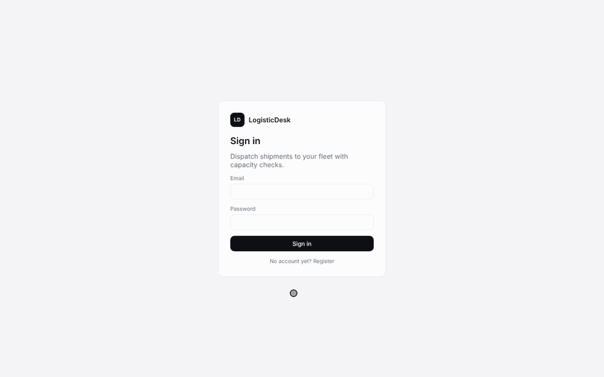
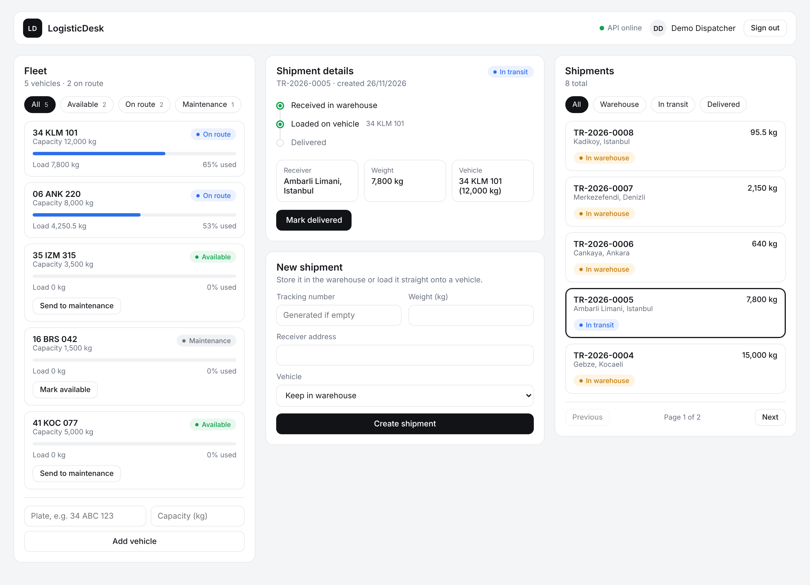
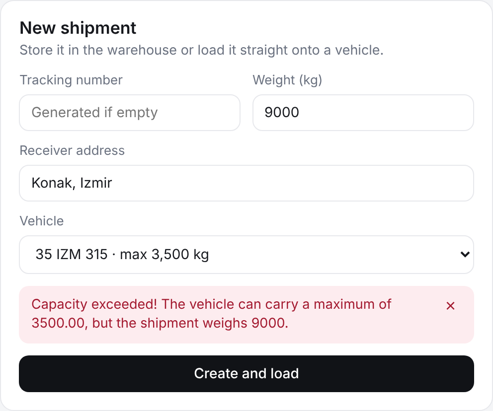
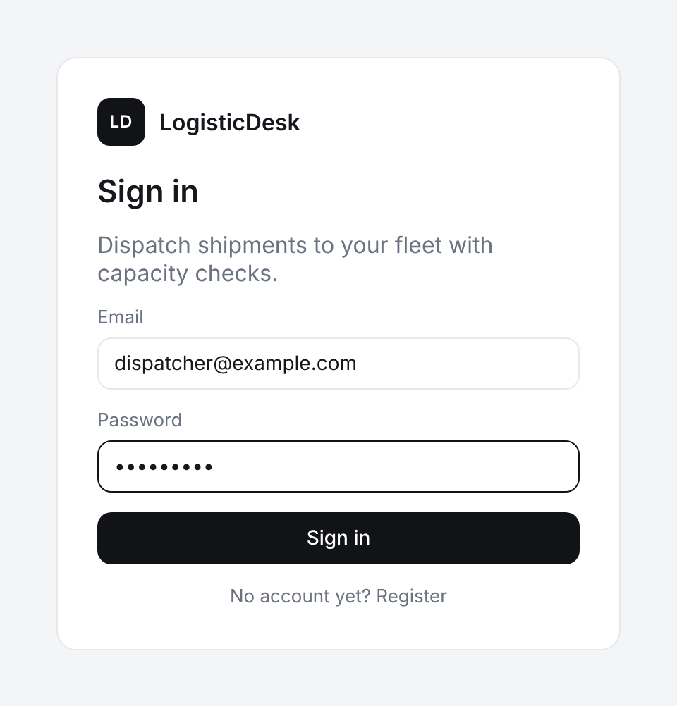
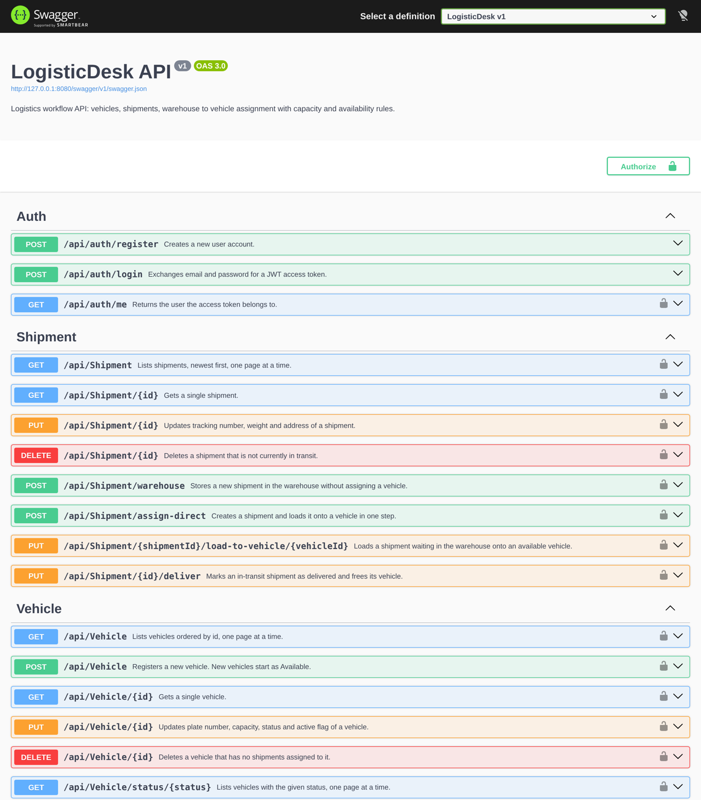
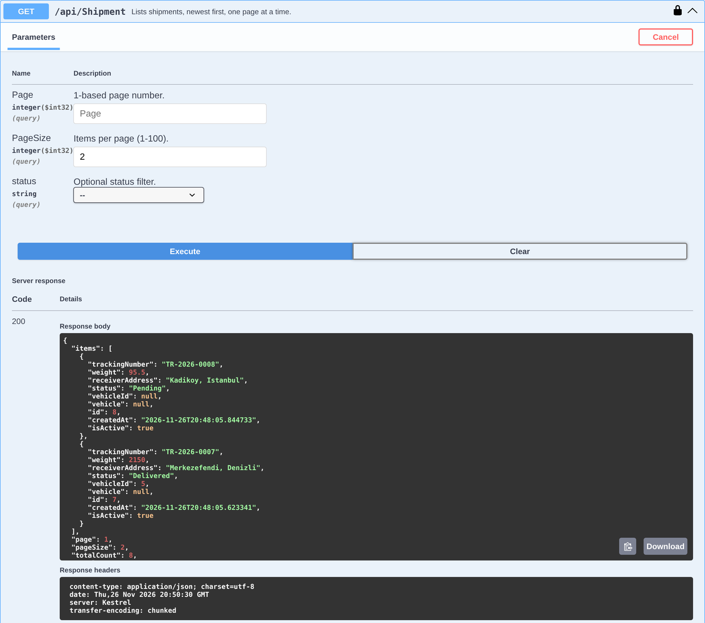
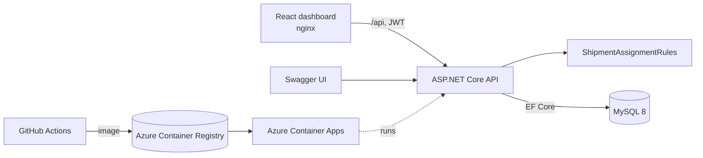

# LogisticDesk

A logistics workflow API in ASP.NET Core with a small React dashboard. Dispatchers register vehicles, take shipments into a warehouse and load them onto trucks. The API refuses any load that a truck can't carry or that goes to a truck that isn't free.

[](https://github.com/bcpasaoglu/Logistic-Workflow-API/actions/workflows/ci.yml)




## Why I built this

I started this project to apply what I was learning as I took my first steps into .NET and backend development. I didn't want another add/delete CRUD app. I wanted real business rules in code and tables that depend on each other. A truck has a capacity, it can be on the road or in maintenance, and a shipment either waits in the warehouse or is loaded onto a truck. Those rules are small enough to fit in one project, but they still make you think about validation, state changes and what the API should say when a request breaks a rule.

## What it does

- Vehicles have a plate, a capacity and a status: `Available`, `OnRoute` or `InMaintenance`.
- A shipment can go into the warehouse first and be loaded later, or it can be loaded onto a truck straight away.
- Loading is checked twice: the truck has to be available, and the shipment has to fit its capacity. A successful load puts the truck `OnRoute`.
- Delivering a shipment frees the truck for its next load.
- The API refuses to delete a truck that still has shipments or a shipment that is in transit. Tracking numbers are unique.
- Users register and sign in with a JWT, and every vehicle and shipment endpoint requires the token.
- Lists are paged, and shipments can be filtered by status.
- Every error comes back in one JSON shape (RFC 7807 ProblemDetails), with the reason in `detail`. The UI shows that text as it is.
- There are liveness and readiness health checks, and Swagger documents every endpoint.

## Screenshots

| Dashboard | Capacity rule in the UI |
| --- | --- |
|  |  |
| **Sign in** | **Swagger UI** |
|  |  |

<details>
<summary>The same calls straight from Swagger</summary>

A paged list: `GET /api/Shipment?pageSize=2`



A 15,000 kg shipment sent to a 5,000 kg truck:


</details>

## How it fits together



| Layer | What is used |
| --- | --- |
| API | C#, .NET 9, ASP.NET Core Web API, ASP.NET Core Identity, JWT bearer auth |
| Data | MySQL 8, Entity Framework Core (code-first migrations, Pomelo provider) |
| Frontend | React 18, TypeScript, Vite, served by nginx |
| Tests | xUnit, EF Core InMemory, `WebApplicationFactory`, Vitest |
| Delivery | Docker, Docker Compose, GitHub Actions (CI and CD), Terraform, Azure Container Apps, Azure Database for MySQL |

There are more diagrams in [docs/architecture.md](docs/architecture.md): the request pipeline, the shipment lifecycle, the data model and the Azure deployment.

```
Controllers/        Auth, Shipment and Vehicle endpoints (+ ProblemDetails base controller)
Services/           ShipmentAssignmentRules, JwtTokenService
Infrastructure/     Global exception handler, Swagger auth filter
DTOs/, Models/      Request models with validation, EF Core entities
Data/, Migrations/  DbContext and migrations
tests/              xUnit unit and integration tests
web/                React dashboard
infra/terraform/    Azure infrastructure
```

## Running it

With Docker, one command starts MySQL, the API and the dashboard:

```bash
docker compose up --build
```

- Dashboard: http://localhost:3000. Register an account there, then sign in.
- Swagger UI: http://localhost:8080/swagger. Sign in with `/api/auth/login`, press **Authorize** and paste the token.

The API runs its migrations on startup. The passwords and JWT key in `docker-compose.yml` are for local use only. You can override them with `MYSQL_PASSWORD`, `MYSQL_ROOT_PASSWORD` and `JWT_SIGNING_KEY`.

Without Docker, you need the .NET 9 SDK, Node 22 and a MySQL server:

```bash
dotnet user-secrets set "ConnectionStrings:DefaultConnection" "Server=localhost;Port=3306;Database=logisticdesk;User=...;Password=...;"
dotnet user-secrets set "Jwt:SigningKey" "$(openssl rand -base64 48)"
dotnet ef database update
dotnet run                       # API on http://localhost:5065

cd web && npm install
API_URL=http://localhost:5065 npm run dev   # dashboard on http://localhost:5173
```

Tests:

```bash
dotnet test LogisticDesk.slnx    # 47 tests: rules, controllers, JWT, full HTTP pipeline
cd web && npm test               # 8 tests: fleet and error helpers
```

To deploy to Azure, follow [infra/README.md](infra/README.md). It provisions everything with Terraform and turns on the CD workflow, which logs in through OIDC, so no cloud secrets are stored in GitHub.

## Technical decisions

**The rules live in one plain class.** `ShipmentAssignmentRules` has no EF Core or HTTP code in it. Both ways of loading a shipment (direct and from the warehouse) call it, so they can't drift apart, and the tests cover it without a database.

**JWT instead of cookies.** The API serves a separate frontend and Swagger, and it may run behind a proxy in the cloud. A stateless bearer token works the same for all of them. Identity still does the password hashing and lockout (5 failed attempts lock the account for 15 minutes). The app won't start without a signing key of at least 32 bytes, so a weak default can't slip into production.

**One error format.** Validation errors, business rule errors and crashes all come back as ProblemDetails with a `traceId`. That's why the dashboard can show the API's own sentence ("Capacity exceeded! ...") instead of a generic "something went wrong". It also means a log line can be matched to the response a user saw.

**Container Apps and Terraform for the cloud.** The app is already a container, so Container Apps runs it with HTTPS and scales it to zero when it's idle, which keeps a demo cheap. Terraform generates the database password and the JWT key and passes them to the app as secrets, so neither ever appears in the repository.

## Known limitations and next steps

- Roles exist in the code (`Manager`, `WarehouseStaff`, ...) but aren't enforced yet. Any signed-in user can do everything.
- Email confirmation is turned off, because no email sender exists yet. Refresh tokens aren't implemented either.
- A truck carries one shipment per trip. A truck that is on the road can't take a second load.
- The integration tests use an in-memory database. Running them against real MySQL with Testcontainers is the next step.
- The Azure setup is written and validated (`terraform validate`), but it isn't deployed anywhere public yet.

## License

MIT, see [LICENSE](LICENSE).
