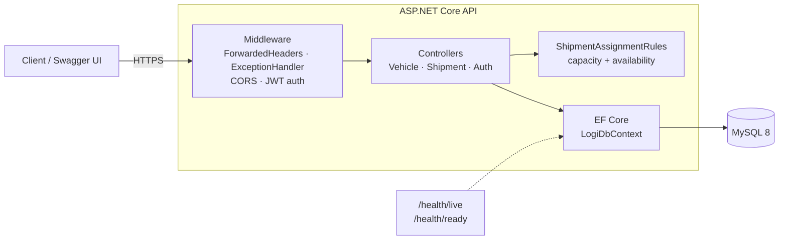
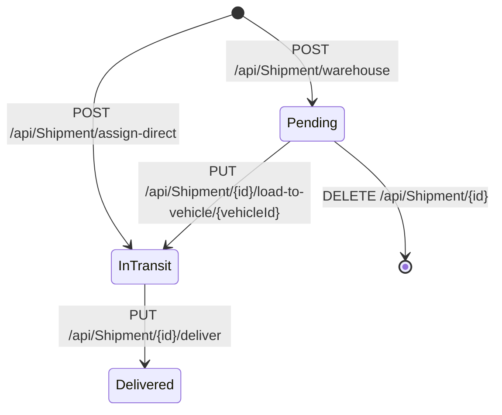
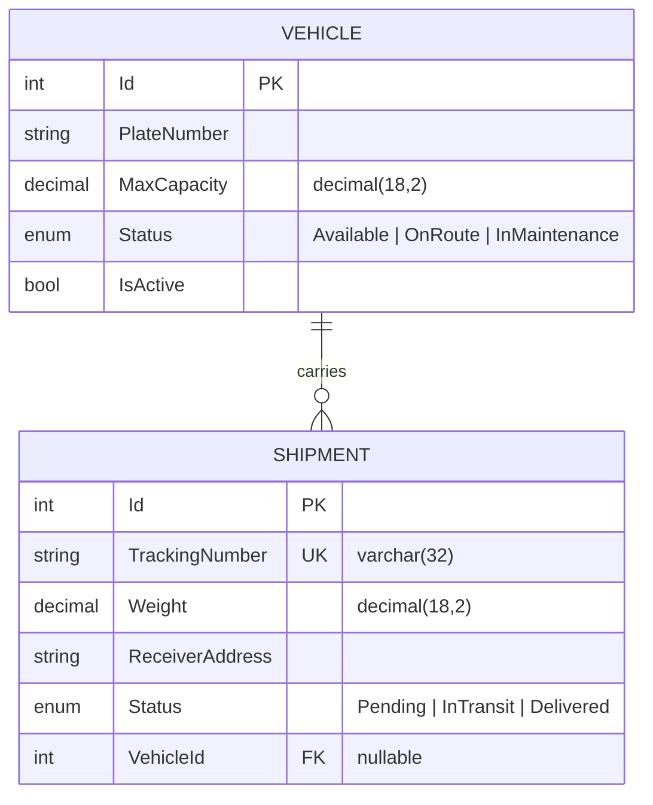
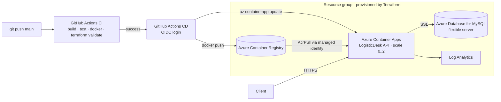

# Architecture

## Request flow inside the API

* **Controllers** validate input (DTO data annotations), page list results and translate business rule failures into `400`, `404` or `409` responses.
* **ShipmentAssignmentRules** holds the logistics rules (vehicle must be `Available`, shipment weight must fit `MaxCapacity`). It has no EF Core or HTTP dependencies, so it is unit tested directly.
* **GlobalExceptionHandler** (`IExceptionHandler`) turns any unhandled exception into an RFC 7807 `ProblemDetails` body with a `traceId`. Database conflicts become `409`, everything else `500`, and exception details are only shown in Development.
* **Authentication**: `POST /api/auth/login` checks the password with ASP.NET Core Identity (including lockout) and returns an HS256 JWT. Vehicle and shipment controllers carry `[Authorize]`; the JWT bearer handler validates issuer, audience, lifetime and signature on each request.
* **Health checks**: `/health/live` only checks that the process runs; `/health/ready` also checks the database. Container Apps uses them as liveness and readiness probes.

## Shipment lifecycle

When a shipment is loaded, its vehicle moves from `Available` to `OnRoute`, so it cannot take another load. Delivering the shipment moves the vehicle back to `Available`.

## Data model

ASP.NET Core Identity tables (`AspNetUsers`, `AspNetRoles`, ...) live in the same database.

## Deployment on Azure

* Terraform (`infra/terraform`) creates every Azure resource. The database password and the JWT signing key are generated by Terraform and handed to the app as Container Apps secrets; neither appears in Git.
* The CD workflow authenticates with OpenID Connect (federated credentials), so the repository stores no Azure secrets, only IDs as repository variables.
* EF Core migrations run on startup (`Database__MigrateOnStartup=true`).
